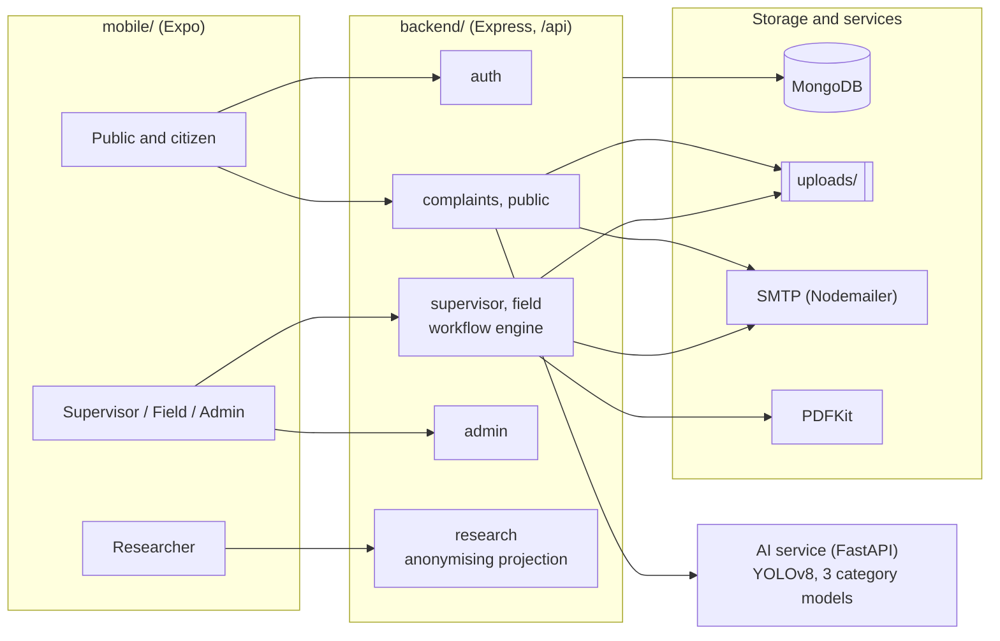
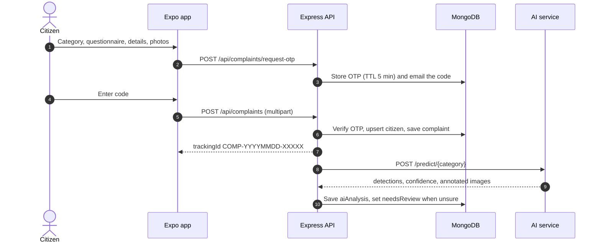
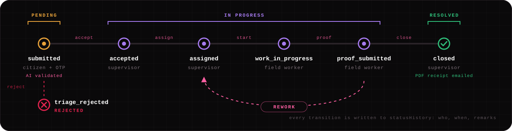

<div align="center">



<br>

<p>
  
  
  
  
  
  
  
</p>

</div>

# UrbanFix

UrbanFix is an AI-powered governance system for civic infrastructure complaints. Citizens report potholes, litter and graffiti from a mobile app without creating an account. A YOLOv8 model trained for the selected category checks each photo, a weighted questionnaire sets the urgency, and a ward-based staff workflow takes the complaint from triage to field repair, photo proof and a closing PDF receipt. Every complaint and its status history is published in a public registry, and approved researchers can export pseudonymised research records.

## Contents

- [Components](#components)
- [Architecture](#architecture)
- [Getting started](#getting-started)
- [Configuration](#configuration)
- [AI models](#ai-models)
- [Complaint workflow](#complaint-workflow)
- [API reference](#api-reference)
- [Security and privacy](#security-and-privacy)
- [Repository layout](#repository-layout)
- [Documentation](#documentation)

## Components

| Directory | Stack | Responsibility |
|:--|:--|:--|
| [`mobile/`](./mobile) | Expo SDK 57, React Native 0.86, React 19, React Navigation 7, Reanimated 4, FlashList, react-native-svg | The only client. Role-based tab sets for citizens, supervisors, field workers, admins and researchers. Runs in Expo Go on Android and iOS, and in the browser for development. |
| [`backend/`](./backend) | Node.js 20, Express 4, Mongoose 8, JWT, bcrypt, Zod, Multer, Nodemailer, PDFKit | REST API: auth and invites, complaint intake with email OTP, workflow engine, attendance and leave, PDF receipts, public registry, research access with audit logging. |
| [`ai_model/`](./ai_model) | Python 3, PyTorch 2.14, Ultralytics 8.4 | Dataset preparation, training and evaluation notebooks and scripts for the three category models, trained weights and evaluation results. |
| [`ai_service/`](./ai_service) | Python 3, FastAPI, Ultralytics 8.4 | Vision service the backend calls after filing. Returns detections, s*, δ and the `needsReview` flag (Eqs. 3 to 5) and annotated photos. |
| [`docs/`](./docs) | Markdown, Word | System description, project report, report figures and README graphics. |

### Roles

| Role | Access | Main capabilities |
|:--|:--|:--|
| Citizen | No account; email OTP per complaint | File, track, download receipt, browse registry |
| Supervisor | Admin invite | Triage, assign within ward, review proof, close or send for rework, approve field leave |
| Field worker | Admin invite | Start assigned tasks, upload proof photos, check in and out, request leave |
| Admin | Admin invite or seed script | Analytics, status override, staff accounts, supervisor leave, research approvals, research audit log |
| Researcher | Public application, admin approval | Grouped queries and CSV or JSON export of anonymised data until access expires |

## Architecture



Complaint submission, end to end:



The AI call runs after the tracking ID is returned, so model latency or failure never blocks a submission.

## Getting started

### Prerequisites

| Tool | Version | Used by |
|:--|:--|:--|
| Node.js and npm | 20 or newer | `backend/`, `mobile/` |
| MongoDB | 7 or newer, running locally | `backend/` |
| Expo Go | Build with SDK 57 support | Testing on a phone (same Wi-Fi as the dev machine) |
| Python | 3.11 or newer | `ai_model/` |

### Backend

```bash
cd backend
cp .env.example .env          # set JWT_SECRET and RESEARCH_HMAC_KEY (openssl rand -hex 32); SMTP is optional
npm install
npm run seed:roles            # one development account per role
npm run seed:complaints       # optional: sample complaints over the last 12 months
npm run dev                   # http://localhost:5001, health check at GET /health
```

Without SMTP settings the backend creates an Ethereal test inbox and logs its credentials, so OTP and status emails can be read during development.

### Mobile app

```bash
cd mobile
npm install
npx expo start --go -c
```

Scan the QR code with Expo Go, press `w` for the browser or `a` for an Android emulator. The app calls the backend on port 5001 of the host that serves Metro, so no API URL is needed locally. See [`mobile/README.md`](./mobile/README.md) for device and browser differences.

### AI service

```bash
cd ai_service
python3 -m venv .venv
.venv/bin/pip install -r requirements.txt
.venv/bin/uvicorn main:app --host 127.0.0.1 --port 8000
```

Set `AI_SERVICE_URL=http://127.0.0.1:8000` in `backend/.env`. Without it, complaints are still filed and are flagged for manual review. See [`ai_service/README.md`](./ai_service/README.md).

### Tests

```bash
cd backend && npm test              # API, OTP, concurrency, audit-log, privacy, urgency and AI tests
cd ai_service && .venv/bin/python -m pytest -q tests
cd backend && npm run test:load     # load test on this machine; results in tests/load/results/
```

`npm test` starts an in-memory MongoDB (`mongodb-memory-server`); set `MONGOMS_SYSTEM_BINARY` to use an installed `mongod` instead of a download. GitHub Actions runs both suites and an end-to-end test on every push (`.github/workflows/test.yml`).

### AI models

Each complaint category has its own YOLOv8 nano model, fine-tuned from COCO weights. A category is offered only if a public dataset of street-level images with localised labels (boxes or masks), documented provenance and a usable licence exists (Eq. 1 of the paper). Three categories qualify: pothole / road damage, garbage / litter and graffiti. The category list is enforced by `backend/constants/categories.js` and mirrored in `mobile/src/constants/categories.js`.

Open manholes were offered until November 2026. The only real-photo dataset found (Kaggle "Road Hazards") names no photographer or source, so the category was withdrawn. Complaints filed under it earlier keep their category and stay readable.

### Datasets and splits (2026 revision)

| Category | Training dataset | Licence | Train / val / test | External test sets |
|:--|:--|:--|:--|:--|
| Pothole / Road Damage | [RDD2022](https://doi.org/10.6084/m9.figshare.21431547), class D40, Japan, Czech Republic, China and India (the United States subset is Google Street View imagery and is excluded) | CC BY 4.0 | 2,836 / 606 / 604 | Roboflow pothole set (297). A variant trained without Indian photos (1,498 / 319 / 318) is tested on all 1,911 Indian photos to measure the geographic gap. |
| Garbage / Litter | [TACO](https://doi.org/10.5281/zenodo.3587843) official annotations | CC BY 4.0 | 1,000 / 214 / 214 | TACO unofficial annotations (2,308) |
| Graffiti | [STORM graffiti/tagging](https://doi.org/10.5281/zenodo.3238357) | CC BY 4.0 | 670 / 143 / 209 (official test split) | none found |

Splits are grouped by source photo (file-name stems plus near-duplicate image hashes), so no photo or edited copy of it appears in two splits; val, test and external sets keep one image per source photo. The split lists are in `ai_model/splits/` and the provenance of every dataset is in [`ai_model/DATASETS.md`](./ai_model/DATASETS.md).

### Models and results

The weights in `ai_model/weights/` are the 2026 models, trained on the splits above (phase 3 of `feedback/action.md`): YOLOv8n for each category, the pothole model trained on RDD2022 including Indian roads (box detector, because RDD2022 has boxes only), litter as segmentation, graffiti as box detection. Their test-set results with 95 % confidence intervals, the baselines (YOLO11n, RT-DETR-l) and the complaint-level screening rates are generated into `ai_model/results/phase3_summary.md`. The models of the submitted paper are in the git history.

Training settings: 640 x 640 images, batch 16, COCO-pretrained, at most 40 epochs with early stopping after 10, Ultralytics default optimiser and augmentation. Each category's threshold τ is in `ai_service/thresholds.json`, chosen on validation data by a written rule.

The vision service that runs the models, its endpoints and τ per category are described in [`ai_service/README.md`](./ai_service/README.md). A low-confidence or empty result marks the complaint `needsReview` for a supervisor; the model never rejects a complaint.

More detail: [`ai_model/README.md`](./ai_model/README.md).

## Complaint workflow

Staff work with a detailed `stage`; the public sees a derived `status`. Transitions are defined in [`backend/utils/complaintStage.js`](./backend/utils/complaintStage.js) and enforced in [`backend/services/complaintWorkflow.js`](./backend/services/complaintWorkflow.js).



| Action | From | To | Allowed roles | Rule |
|:--|:--|:--|:--|:--|
| `accept` | `submitted` | `accepted` | supervisor, admin | remarks of 10+ characters |
| `reject` | `submitted` | `triage_rejected` | supervisor, admin | remarks of 10+ characters |
| `assign` | `accepted`, `assigned` | `assigned` | supervisor, admin | same ward (admin may override); assignee active and not on leave |
| `start` | `assigned` | `work_in_progress` | field | assignee only |
| `proof` | `work_in_progress` | `proof_submitted` | field | completion note, up to 3 photos |
| `close` | `proof_submitted` | `closed` | supervisor, admin | remarks; PDF receipt emailed to citizen |
| `rework` | `proof_submitted` | `assigned` | supervisor, admin | remarks of 10+ characters |

Status mapping: `submitted` is Pending, `triage_rejected` is Rejected, `closed` is Resolved, every other stage is In Progress. Each transition appends status, stage, actor, remarks and timestamp to `statusHistory`.

## API reference

All routes are prefixed with `/api`; uploaded files are served from `/uploads`. Protected routes expect `Authorization: Bearer <JWT>`.

| Prefix | Auth | Endpoints |
|:--|:--|:--|
| `/api/auth` | public, `GET /me` authenticated | `POST /register`, `/verify-otp`, `/resend-otp`, `/login`, `/set-password`; `GET /me` |
| `/api/complaints` | public, `/my-complaints` citizen | `POST /request-otp`, `POST /` (multipart, field `images`, max 3); `GET /track/:trackingId`, `/download-receipt/:trackingId`, `/my-complaints` |
| `/api/public` | public | `GET /complaints?category&status&ward&location&page&limit`, `GET /stats` |
| `/api/supervisor` | supervisor, admin | `GET /queue`, `/complaints/:id`, `/field-staff`, `/stats`, `/leave`; `PATCH /complaints/:id/{accept,reject,assign,close,rework}`, `/leave/:id` |
| `/api/field` | field | `GET /tasks`, `/tasks/:id`, `/stats`, `/leave`, `/attendance`; `PATCH /tasks/:id/start`; `POST /tasks/:id/proof`, `/leave`, `/attendance/check-in`, `/attendance/check-out` |
| `/api/admin` | admin | `GET /stats`, `/activity-heatmap`, `/complaints`, `/users`, `/research-applications`, `/audit/research`, `/leave`; `POST /users`; `PATCH /complaints/:id/status`, `/users/:id`, `/users/:id/{deactivate,reactivate}`, `/research-applications/:id`, `/leave/:id` |
| `/api/research` | `POST /apply` public, rest researcher or admin | `GET /me`, `/dashboard`, `/query`, `/export?format=csv\|json` |

Errors return `{ "status": "fail", "message": "..." }` for 4xx responses and `"status": "error"` for 5xx. Request bodies are validated with Zod.

## Security and privacy

| Area | Implementation |
|:--|:--|
| Citizen identity | No accounts; per-complaint email OTP (6 digits, TTL index, 5 min). Public responses omit `citizenId`, and the filer appears as "Citizen" in timelines. |
| Staff onboarding | Admin-created accounts receive a 72-hour invite link; only the SHA-256 hash of the token is stored. Login is blocked until the password is set. |
| Authentication | bcrypt (cost 12), JWT (default 7 days), role checks on every protected route, deactivated users rejected. |
| Audit trail | Staff are soft-deleted (`isActive: false`) so history references stay valid. |
| Research data | One projection strips identity, free text, street address, tracking ID and photos; location coarsened to ward, filing date to quarter, no closing date or resolution time; record IDs are per-researcher HMACs. Records in classes of fewer than 5 identical records are withheld (k = 5) and aggregate counts below 5 are hidden; the generalisation was chosen on Chicago 311 data (`analysis/privacy/`). Exports capped at 5 per day and 5,000 rows, CSV cells guarded against formula injection, every access logged, hard expiry with a 3-day email warning. |

## Repository layout

```
.
├── README.md
├── mobile/                          Expo app
│   ├── App.js, index.js, index.web.js
│   ├── app.json                     Expo config
│   ├── assets/                      app icons and splash
│   ├── README.md                    device and browser notes
│   └── src/
│       ├── navigation/              role-based tab sets, deep links (dsn://)
│       ├── screens/                 public/ citizen/ supervisor/ field/ admin/ research/
│       ├── components/              shared UI, charts, tab bar
│       ├── services/                api.js (Axios + JWT), tokenStore.js
│       ├── config/                  chart theme
│       ├── constants/               categories, stages, wards, icons
│       ├── contexts/ hooks/ utils/
│       └── theme.js
├── backend/                         Express API
│   ├── server.js                    entry point, mounts /api routes
│   ├── .env.example                 environment template
│   ├── config/                      database connection
│   ├── routes/ controllers/         auth, complaints, public, supervisor, field, admin, research
│   ├── models/                      User, Complaint, Otp, LeaveRequest, AttendanceRecord, Research*
│   ├── services/                    workflow engine, email, PDF receipts, expiry job
│   ├── constants/ validators/ middleware/ utils/
│   └── scripts/                     seed and backfill scripts
├── ai_model/
│   ├── notebooks/                   00 to 06: download, prepare, train, evaluate, figures
│   ├── weights/                     trained category models (.pt)
│   ├── results/                     eval.json and split metadata
│   ├── road_damage.ipynb            standalone road damage training notebook
│   ├── Pothole_Segmentation_YOLOv8.v1i.yolov8/   pothole dataset (git-ignored, from Roboflow)
│   ├── requirements.txt
│   └── README.md
├── paper/                           IEEE paper
│   ├── urbanfix_ieee_access/        IEEE Access submission: latex/, PDF, DOCX, cover letter, graphical abstract
│   ├── urbanfix_paper/              earlier IEEE conference draft (LaTeX)
│   ├── figures/                     all paper figures F01 to F53 (PNG, SVG, PDF), README.md
│   ├── related_work/                prior papers cited in the literature review
│   └── templates/                   IEEE conference LaTeX template
└── docs/
    ├── project_description.md       full system description
    ├── project_report/
    │   ├── project-report.pdf       final project report
    │   ├── report.docx, report.pdf  Project Exhibition I report (editable source)
    │   ├── UrbanFix_Literature_Survey.pdf
    │   └── figures/                 report-only figures, INDEX.md (shared ones live in paper/figures/)
    ├── assets/                      README graphics
    └── sample-images/               test photos
```

`ai_model/data/` and `ai_model/runs/` are created by the notebooks and are git-ignored. The pothole dataset is also git-ignored; download it from Roboflow into `ai_model/Pothole_Segmentation_YOLOv8.v1i.yolov8/`. `node_modules/` and `backend/uploads/` are created by `npm install` and at runtime.

## Documentation

| Document | Contents |
|:--|:--|
| [`docs/project_description.md`](./docs/project_description.md) | Modules, schemas, every endpoint, AI pipeline |
| [`docs/project_report/report.pdf`](./docs/project_report/report.pdf) | Project Exhibition I report |
| [`docs/project_report/project-report.pdf`](./docs/project_report/project-report.pdf) | Final project report |
| [`docs/project_report/figures/INDEX.md`](./docs/project_report/figures/INDEX.md) | Report figures with data sources |
| [`paper/figures/README.md`](./paper/figures/README.md) | Paper figures F01 to F53 with captions |
| [`ai_model/README.md`](./ai_model/README.md) | Model training, results and dataset licences |
| [`mobile/README.md`](./mobile/README.md) | Running the app on devices and in the browser |

## Authors

Parth Pancholi, School of Computing Science and Engineering, VIT Bhopal University. Project Exhibition I (DSN2098), supervised by Dr. Gaurav Soni.
